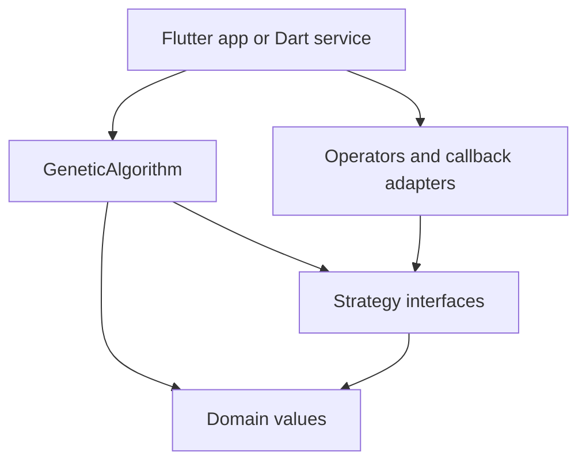

# Architecture

## Design intent

The framework separates the evolution lifecycle from problem-specific behavior.
The engine depends on small interfaces. Concrete operators and callback adapters
implement those interfaces. A consumer composes them through one public import:
`package:genetic_engine/genetic_engine.dart`.

## Source map

| Location | Responsibility | Dependency rule |
| --- | --- | --- |
| `lib/genetic_engine.dart` | Deliberate public exports | No runtime logic |
| `lib/src/domain/` | Candidate, generation, result, objective, stop reason | Dart SDK and other domain values only |
| `lib/src/contracts/` | Factory, evaluator, selection, crossover, mutation | SDK and domain only |
| `lib/src/adapters/` | Function-to-interface adapters and convenience functions | Contracts, domain, built-in operators for convenience facade |
| `lib/src/operators/selection/` | On-demand selectors, SUS and shared weight validation | Selection/batch contracts and domain |
| `lib/src/operators/crossover/` | Fixed-list and permutation crossovers | Crossover contract and parent validation helper |
| `lib/src/operators/mutation/` | Binary, real and sequence mutations | Mutation contract |
| `lib/src/engine/` | Evolution orchestration and input validation | Contracts, domain, callback adapters |
| `test/contracts/` | Consumer extension scenarios | Public entry point only |
| `test/operators/` | Operator invariants and boundaries | Public entry point only |
| `test/genetic_engine_test.dart` | End-to-end evolutionary behavior | Public entry point only |

The engine imports callback adapter classes to construct the function-oriented
entry point, but never imports a concrete genetic operator. There is no service
locator, mutable global registry, framework base class, or Flutter dependency.
Consumers should not import `src/` paths. Internal files may move between releases.

## Contracts

| Interface | Method | Caller obligation |
| --- | --- | --- |
| `GenomeFactory<T>` | `create(Random)` | Produce an immutable genome |
| `FitnessEvaluator<T>` | `evaluate(T)` | Return finite fitness without mutating the genome |
| `Selection<T>` | `select(List<Candidate<T>>, Random)` | Treat the nonempty, ranked population as read-only |
| `BatchSelection<T>` | `selectMany(ranked, count, Random)` | Return exactly count parents without shared state |
| `Crossover<T>` | `cross(T, T, Random)` | Preserve both parents and representation validity |
| `Mutation<T>` | `mutate(T, Random)` | Preserve the input and representation validity |

## Lifecycle and ownership

`run` creates its own random source, population, best-ever candidate and stagnation
counter. It evaluates generation zero and reports progress. If no stop condition
holds, it carries elites forward, breeds and evaluates the remaining children,
ranks the population, updates best-ever state and repeats.

The engine's private methods isolate evaluation, ranking, reproduction,
advancement and stop priority. Constructor checks guard external configuration;
evaluation checks the user-supplied score boundary. Compatible genome structure
is a strategy-level obligation, so crossover validates its own parents.

Population lists are copied into unmodifiable views. This is shallow immutability:
custom genomes and their nested fields are owned by the application. Built-in
operators produce unmodifiable lists and never modify parents. Elites are neither
mutated nor re-evaluated; fitness should be deterministic for this behavior.

## Decisions and limits

- Use composition and interfaces rather than inheritance from the engine.
- Keep callback adapters for small problems and migration from pre-release 0.1.
- Support one synchronous scalar objective. Constraints are encoded through finite
  penalties or repaired by custom operators. Pareto optimization is outside scope.
- Keep execution policy outside the core. Isolates, workers, HTTP, persistence,
  authentication and progress transport belong to application integration.
- Do not retain every generation automatically; applications choose history cost.
- Preserve the existing evolution behavior while replacing its extension boundary.

See [integration](integration.md) for runtime boundaries and
[extending](extending.md) for a complete custom strategy.

## Additional policy boundaries (0.3)

`Elitism` resolves an unchanged survivor count at engine construction.
`Termination` evaluates immutable `EvolutionState` observations per generation;
composite conditions retain no counters. The engine owns the stopwatch and all
run state. Legacy integer elitism and callback constructors remain supported.

## Batch selection boundary (0.4)

An engine accepts exactly one of `Selection<T>` or `BatchSelection<T>`. This keeps
single-parent strategies compatible and avoids concrete operator type checks.
The engine never imports SUS: it only knows that a batch strategy returns the
requested number of parents. A length mismatch fails at that contract boundary.

Each generation requests twice the offspring count, shuffles a copied pool, and
allocates disjoint pairs. The reproduction function consumes a parent supplier,
so crossover and mutation decisions live in one place for both modes. Batch
selection, pointer traversal and shared roulette/SUS weight validation belong to
operators; pair allocation belongs to orchestration. No pool survives a generation.
See [selection semantics](selection.md) for unused second parents at crossover
rates below one. Parallel execution remains outside the core.
