# Flutter lab validation — 2026-11-17

## Circular language controls — 2026-11-17

The final navbar uses locally painted circular Brazil / UK flags. These are vector
flag renditions in repository-owned MIT code, not emoji or downloaded assets.
Names remain available as tooltips and semantic button labels; selected state is
announced and shown with an outline plus check. Each target is 48×48 and supports
keyboard focus/Enter. Switching preserves the experiment and saved preference.

- All 19 local Flutter tests passed in one sequential run. After replacing a
  deprecated semantics assertion with the current flagsCollection API, the focused
  flag test passed again; the other 18 behaviors did not change. Analysis passed
  with no issues and the release Web build passed. Core/model remain unchanged.
- The flag test covers explicit names, tooltip, selection semantics, target size,
  keyboard activation and accessibility guidelines. Navigation/locale tests now
  activate the actual flag controls and continue testing persistence and presets.
- Chrome inspection confirmed recognizable circular flags at desktop/390px sizes,
  selected outlines/checks, translated Learn content and real documentation opening
  in a separate tab. Existing 18-test navbar deployment is successful; this is its
  small requested follow-up, with final CI/deployment evidence recorded below.

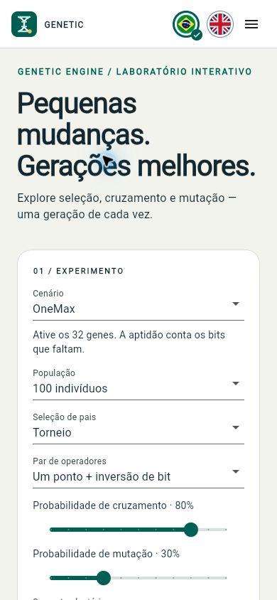

Published application SHA: `b96aecedb18d6d3449951d5dfcff3fca5fbb8152`.

- [Final lab analysis, 19 tests, release build and Pages deployment: successful](https://github.com/kleberandrade/genetic-engine/actions/runs/44179702301).
- [Dart minimum/stable checks: successful](https://github.com/kleberandrade/genetic-engine/actions/runs/44179702279).
- [Hosted Dart/Flutter consumer validation: successful](https://github.com/kleberandrade/genetic-engine/actions/runs/44179702357).
- [Verified live app](https://kleberandrade.github.io/genetic-engine/): desktop and
  390px navbar/flags/Learn were inspected. OneMax generation 1, best 9.000 and mean
  13.580 survived Learn navigation and a switch to English. The mobile TSP preset
  opened generation zero with population 200, Rank, Order/reverse, mutation 40%,
  best 3.091 and mean 4.739; changing back to Português retained those values.
- Page, main.dart.js, flutter_bootstrap.js, SVG favicon and CanvasKit WASM all
  returned HTTP 200 with appropriate content types; the published favicon parsed
  as SVG XML. README and About link to the actual app; eleven topics are retained.

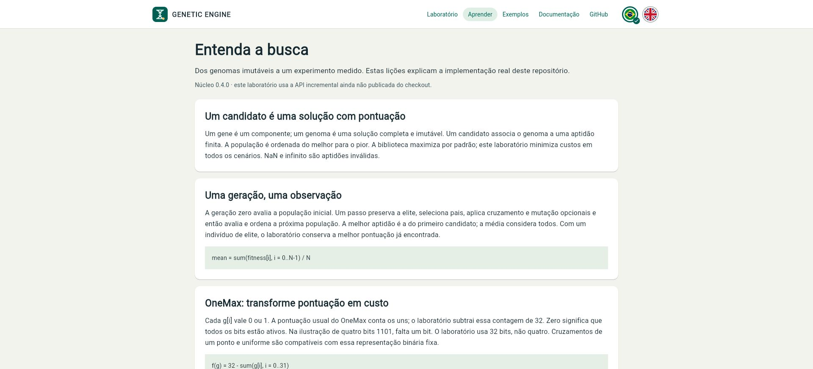

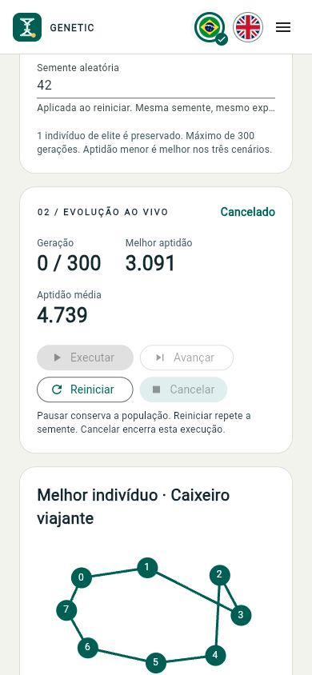

The final evidence-only documentation commit uses `[skip ci]` and does not change
the deployed application artifact. No pub.dev release or other service was used.

## Branded navbar and integrated Learn — 2026-11-17

The lab now includes responsive Laboratory/Learn/Examples navigation, a persistent
language selector, original vector branding and actual project documentation / GitHub
links. The core library, core tests and optimization model remain unchanged.

- Red: the first navigation test failed because Learn was missing.
- **18 Flutter tests passed**, including paused navigation and language switching,
  all three real preset loads, mobile keyboard selection with 150% text, labeled
  and Android touch-target guidelines, and reference destinations. A separate
  formula accessibility assertion failed before explicit semantic nodes were added;
  it now passes and browser AX inspection exposes each formula as readable text.
- Flutter analysis passed without issues; JavaScript release Web build passed with
  the existing `/genetic-engine/` base path, local web resources and no Wasm dry run.
- Compact mark, wordmark and SVG favicon are original crossing-genome artwork with
  a gold mutation node. All SVGs passed XML parsing; no borrowed logo assets.
- Eight repository / document URLs returned HTTP 200. The lesson uses real
  getting-started, selection, operators, examples, integration and research sources.
  It distinguishes published core 0.4.0 from the checkout's incremental API.
- Learn contains complete English/pt-BR explanations, interpreted formulas, source
  references and exactly five practical objective/completion exercises. Examples
  offers three real configurations; loading one intentionally resets the run.
- Chrome desktop and 390px UI were inspected in both languages, including the
  compact menu and loading the queen/SUS preset. Keyboard menu behavior is verified
  by Flutter interaction tests; browser automation did not independently confirm
  physical-key handling. No broader assistive-technology audit is claimed.
- Changed-file secret-pattern scan found no matches; diff whitespace checks passed.
  crapper/dryer/mutator remain unsupported for Dart and produce no usable metrics.

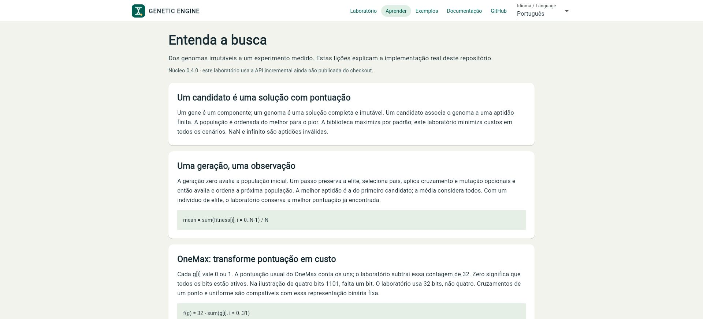

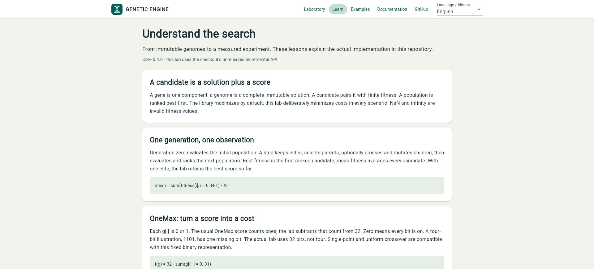

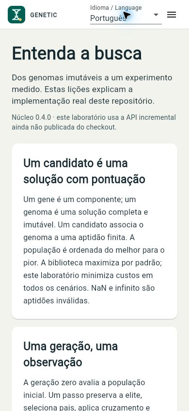

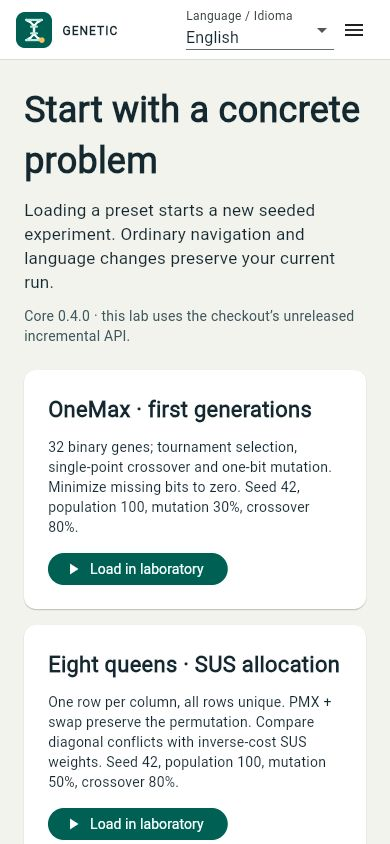

The initial navbar/Learn source `727b32ba11ff82ec4dce8ef565bed4d0ab05d3b2`
passed [lab validation and Pages deployment](https://github.com/kleberandrade/genetic-engine/actions/runs/44177801508),
[Dart minimum/stable CI](https://github.com/kleberandrade/genetic-engine/actions/runs/44177801349)
and [hosted consumers](https://github.com/kleberandrade/genetic-engine/actions/runs/44177801144).
The circular flag follow-up at the top supersedes its dropdown language control.

## Remembered language update — 2026-11-17

This update supersedes the session-only behavior recorded below. On Web, an
explicit language choice is stored as `en` or `pt` in the origin-local
`genetic_engine_lab.language` key. Startup uses a valid saved code first, then
the first supported browser language in preference order, then English. Regional
English/Portuguese variants are matched by language. Detection alone does not
write an explicit preference. Clearing site data removes it; blocked storage
retains session switching. Native previews detect platform locale without disk
persistence. There are no new dependencies or core/model changes.

- Red: the pt-BR first-visit widget test failed to find Portuguese before the fix.
- All **14 Flutter tests** passed, including saved-choice precedence, app recreation,
  regional/ordered/unsupported/empty browser locales, invalid stored values,
  failed reads/writes and the existing lifecycle and accessibility checks.
- Flutter analysis and release JavaScript Web build passed using the same pinned
  SDK and deployment flags. Dart quality tools remain unsupported.
- First Chrome load of the new local build selected Português without interaction.
  Selecting English and reloading restored English; selecting Português and
  reloading restored Português. The screenshots below were taken after reloads.

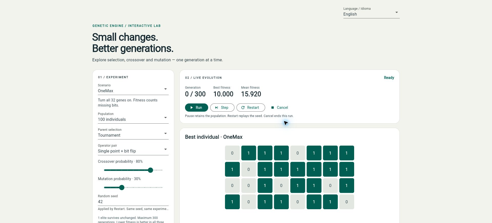

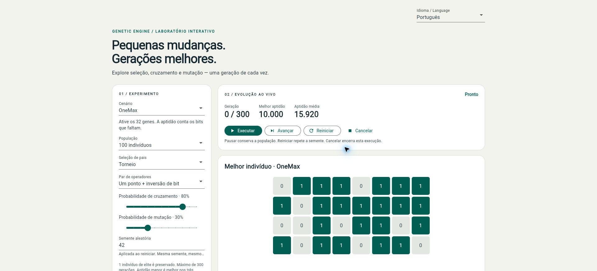

Published source: `bf032ce91c560554ec874d24c44341668e568da0`.

- [Flutter lab: 14 tests, analysis, release build and Pages deployment passed](https://github.com/kleberandrade/genetic-engine/actions/runs/44172407042).
- [Core Dart minimum/stable validation passed](https://github.com/kleberandrade/genetic-engine/actions/runs/44172407245).
- [Hosted Dart/Flutter consumers passed](https://github.com/kleberandrade/genetic-engine/actions/runs/44172406996).

The [public lab](https://kleberandrade.github.io/genetic-engine/) initially selected
Português after loading the new bundle. Choosing English and reloading restored
English, overriding the browser-derived Portuguese. Português was selected again
at the end. A hard refresh was needed to replace an older cached app bundle.

The evidence-only follow-up commit uses `[skip ci]`; application code is identical
to the successful deployment above.

## English/Portuguese update — 2026-11-17

The lab now has an always-available **Language / Idioma** selector. English remains
the initial language; choosing Português changes controls, scenario explanations,
statuses, errors, history labels, population inspection and accessibility copy.
Material controls and semantic language also follow the selected locale.

- The new switch test was observed failing before the selector existed.
- All **eight Flutter tests** passed, covering the three original scenarios,
  lifecycle controls, English/Portuguese paused-run switching without resetting
  generation, translated scenarios/errors and a Portuguese 390×844 layout with
  150% text and labeled/Android touch-target guidelines.
- Flutter analysis passed without issues; the release JavaScript web build passed
  with the existing Pages base path and local web resources.
- Chrome inspection confirmed generation 1 and its best/mean values survived
  English → Português. The document and semantics DOM language became `pt`.
  Desktop/mobile controls and the translated history axis were visually checked.
- Root `lib/`, root `test/`, and the lab optimization model have no changes.
  No dependency or shared SDK changes were required. The choice is session-only.
- crapper/dryer/mutator still cannot analyze Dart; no new metric is claimed.

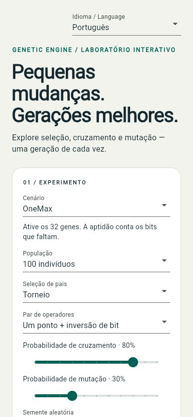

The update was deployed successfully from `82d1e135198c3fcc7ca749fd6636c8014c5674f6`:

- [Flutter lab: eight tests, analysis, release build and Pages deploy passed](https://github.com/kleberandrade/genetic-engine/actions/runs/44170963068).
- [Dart minimum/stable checks passed](https://github.com/kleberandrade/genetic-engine/actions/runs/44170963263).
- [Hosted Dart/Flutter consumers passed](https://github.com/kleberandrade/genetic-engine/actions/runs/44170963119).

On the [live lab](https://kleberandrade.github.io/genetic-engine/), Step advanced to
generation 1 and selecting Português preserved generation 1, best 9.000 and mean
13.580 while translating controls and descriptions. Chrome initially reused the
previous cached bundle; a hard refresh loaded the new deployment. If an existing
browser session still shows the previous interface, use a hard refresh.

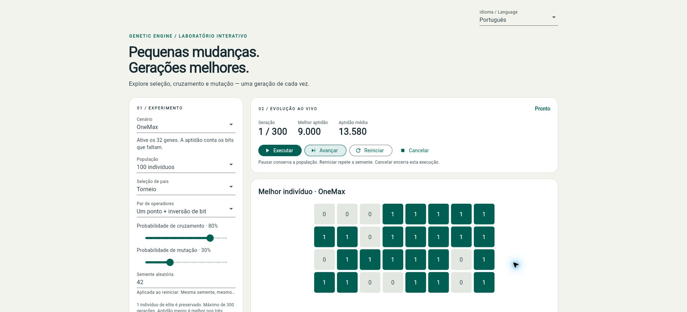

The following evidence-only documentation commit uses `[skip ci]` and does not
change the application artifact validated above.

## Initial release validation

## Scope and environment

Validated source checkout, not a new pub.dev release. The root package version
remains 0.4.0. The lab is `publish_to: none` and uses a local path dependency.
Flutter 3.50.0 (framework ab2912035e), Dart 3.14.0, material_ui 1.11.1;
toolchain copied into an isolated temporary directory. No shared Flutter SDK
was modified. Application dependency versions are pinned in its committed lockfile.
`flutter pub outdated` confirmed all direct dependencies up to date.
Two newer transitive versions (material_color_utilities/test_api) are
incompatible with Flutter's pinned constraints; no overrides were forced.

## Automated checks

- Root formatting and `dart analyze --fatal-infos`: passed.
- Root `dart test`: 55 passed. The new public-API test was first observed failing
  for missing `generations()`, then passed after extracting the shared lifecycle.
- All nine CLI examples: ran successfully, including eight queens and closed TSP.
- Lab `flutter analyze --no-pub`: passed with no issues.
- Lab `flutter test --no-pub`: five tests passed: seeded scenario replay and genome
  validity; every exposed operator combination; step/pause/resume/cancel/restart;
  390×844 with 150% text, labeled controls and Android touch-target guidelines;
  invalid seed recovery. A chart-width regression test reproduced width 0 before
  fixing the responsive chart. This is not a complete assistive-technology audit.
- Release `flutter build web --base-href /genetic-engine/
  --no-web-resources-cdn --no-wasm-dry-run`: passed. Assets are served locally,
  including CanvasKit; the Wasm compatibility dry run is deliberately disabled.
  This validates the JavaScript release build, not a Wasm build.
- `dart pub publish --dry-run`: final clean-checkout validation passed with **0
  warnings**, after correcting the application lockfile ignore rule. Compressed
  package size was 65 KB. No package was published.
- crapper, dryer (0.8) and mutator scan: **unsupported for Dart**; all reported no
  supported source files. No complexity, duplication or mutation score is claimed.

## Browser checks and real captures

The release build was served under `/genetic-engine/` in Chrome. The actual UI
was inspected, including binary genes, board, closed route, history and controls.
The following are screenshots of the running app, not generated mockups.

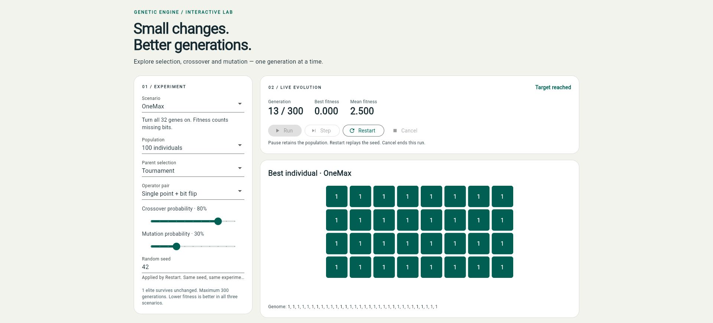

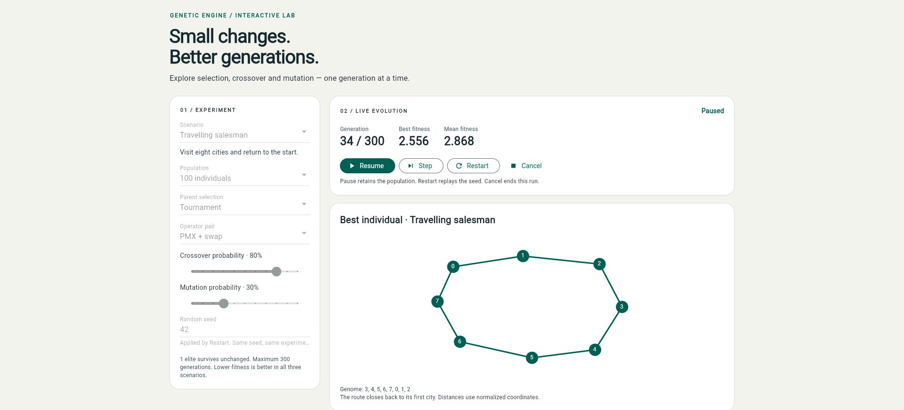

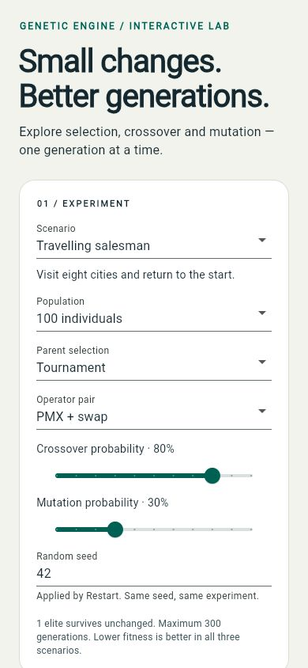

Browser observations: default OneMax reached zero missing bits at generation 13;
eight queens reached zero diagonal conflicts at generation 1. TSP was paused at
generation 34 (best 2.556), remained frozen, then cancelled; Restart reproduced
generation zero (best 3.091). Scenario selection also worked using arrow keys.
The expanded population list and corrected full-width history were inspected.

## Delivery

GitHub Pages was absent before this work. Repository Pages configuration now uses
GitHub Actions, with eleven verified relevant topics and an updated About description
and homepage. The workflow tests the pure Dart core and Flutter lab, then builds
with `/genetic-engine/` before deployment. Pull requests cannot deploy.

The first remote core format check exposed a package-boundary issue: without
resolving the nested application, root formatting used the core language version
for Flutter files. Core formatting now targets CLI examples; the lab workflow
formats its own source after resolving dependencies.

Final application source: commit `615c62ad169ab40d4e002f78ba627e6c67a30949`.

- [Dart CI: successful on minimum 3.3.0 and stable 3.14.1](https://github.com/kleberandrade/genetic-engine/actions/runs/44169393650).
- [Hosted Dart/Flutter consumers and benchmarks: successful](https://github.com/kleberandrade/genetic-engine/actions/runs/44169393602).
- [Flutter lab validation, release build and Pages deploy: successful](https://github.com/kleberandrade/genetic-engine/actions/runs/44169392837).
- [Live lab](https://kleberandrade.github.io/genetic-engine/) opened successfully
  in Chrome. **Step** advanced OneMax from generation 0 (best 10, mean 15.920) to
  generation 1 (best 9, mean 13.580), confirming execution in the published app.

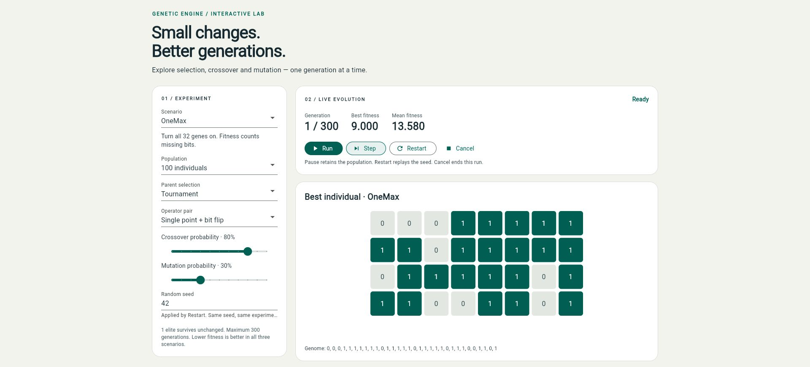

The final evidence-only documentation commit uses `[skip ci]`; no application
source or deployed artifact differs from the successful run above.
No paid service, shared SDK change, release tag or pub.dev publication is involved.

Badge transport check: the existing Dart CI and published-consumer GitHub badge
URLs returned HTTP 200. The shields.io URLs returned HTTP 403 in this environment;
their rendered values could not be reverified here and were not presented as a
new verified score. The existing badges were retained. The new native GitHub lab badge also
returned HTTP 200 after its successful workflow.
