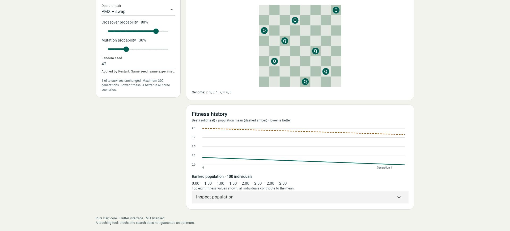
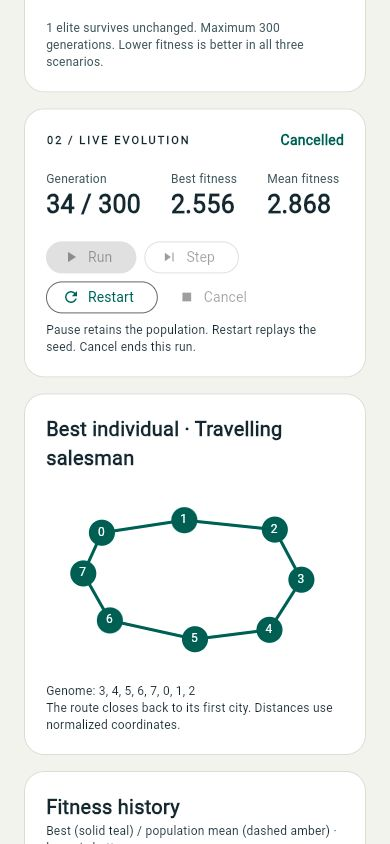

# Flutter lab validation — 2026-11-17

## Scope and environment

Validated source checkout, not a new pub.dev release. The root package version
remains 0.4.0. The lab is `publish_to: none` and uses a local path dependency.
Flutter 3.50.0 (framework ab2912035e), Dart 3.14.0, material_ui 1.11.1;
toolchain copied into an isolated temporary directory. No shared Flutter SDK
was modified. Application dependency versions are pinned in its committed lockfile.
Two newer cached transitive versions (material_color_utilities/test_api) are
incompatible with Flutter's pinned constraints; no overrides were forced.

## Automated checks

- Root formatting and `dart analyze --fatal-infos`: passed.
- Root `dart test`: 55 passed. The new public-API test was first observed failing
  for missing `generations()`, then passed after extracting the shared lifecycle.
- All nine CLI examples: ran successfully, including eight queens and closed TSP.
- Lab `flutter analyze --no-pub`: passed with no issues.
- Lab `flutter test --no-pub`: five tests passed: seeded scenario replay and genome
  validity; every exposed operator combination; step/pause/resume/cancel/restart;
  390×844 with 150% text, labeled controls and Android touch-target guidelines;
  invalid seed recovery. A chart-width regression test reproduced width 0 before
  fixing the responsive chart. This is not a complete assistive-technology audit.
- Release `flutter build web --base-href /genetic-engine/
  --no-web-resources-cdn --no-wasm-dry-run`: passed. Assets are served locally,
  including CanvasKit; the Wasm compatibility dry run is deliberately disabled.
  This validates the JavaScript release build, not a Wasm build.
- `dart pub publish --dry-run`: package validation completed with one warning
  about uncommitted source files at the time of the check. No package was published.
- crapper, dryer (0.8) and mutator scan: **unsupported for Dart**; all reported no
  supported source files. No complexity, duplication or mutation score is claimed.

## Browser checks and real captures

The release build was served under `/genetic-engine/` in Chrome. The actual UI
was inspected, including binary genes, board, closed route, history and controls.
The following are screenshots of the running app, not generated mockups.

Browser observations: default OneMax reached zero missing bits at generation 13;
eight queens reached zero diagonal conflicts at generation 1. TSP was paused at
generation 34 (best 2.556), remained frozen, then cancelled; Restart reproduced
generation zero (best 3.091). Scenario selection also worked using arrow keys.
The expanded population list and corrected full-width history were inspected.

## Delivery

GitHub Pages was absent before this work. Repository Pages configuration now uses
GitHub Actions, with eleven verified relevant topics and an updated About description
and homepage. The workflow tests the pure Dart core and Flutter lab, then builds
with `/genetic-engine/` before deployment. Pull requests cannot deploy.

The live deployment result and workflow links are appended after remote checks.
No paid service, shared SDK change, release tag or pub.dev publication is involved.

Badge transport check: the existing Dart CI and published-consumer GitHub badge
URLs returned HTTP 200. The shields.io URLs returned HTTP 403 in this environment;
their rendered values could not be reverified here and were not presented as a
new verified score. The existing badges were retained.
